# BatchBite: Initial Design Document

**Version:** 1.0 (Sprint 1)

**Date:** 16 October 2026

**Project:** BatchBite, a preorder and production platform for small food businesses

**Team:** Abdulrahman Kamal Almaghraby, Ali Mohamed J. Alfardan, Kishan Biju, Muhammad Shaheem and Saad Zeyad Alalyan

**Figma file (view only):** https://www.figma.com/design/kGIH8fVIBXmGCX8LAoIqQp/Untitled?node-id=0-1&t=5fuOyMTOfvGKWUcx-1
 
---
 
## Table of Contents
1. [Introduction](#1-introduction)
2. [Design Approach](#2-design-approach)
3. [High-Level Architecture](#3-high-level-architecture)
4. [User Roles](#4-user-roles)
5. [Wireframes](#5-wireframes)
6. [UML Class Diagram](#6-uml-class-diagram)
7. [Order State Diagram](#7-order-state-diagram)
8. [Requirements Traceability](#8-requirements-traceability)
9. [Design Decisions and Assumptions](#9-design-decisions-and-assumptions)
10. [Out of Scope for Sprint 1](#10-out-of-scope-for-sprint-1)
---
 
## 1. Introduction
 
BatchBite helps home bakers, student food stalls and small kitchens manage limited
production through advance orders. A business opens a **production batch** (for example,
40 dessert boxes for Thursday), customers order and choose a pickup time, and the business
sees confirmed demand instead of scattered messages.
 
This document covers the **initial design** produced in Sprint 1. It translates the
requirements in [`Requirements.md`](../Requirements.md) into:
 
- a high-level architecture,
- the main screens (wireframes),
- a class diagram of the core data model,
- a state diagram of the order life cycle.
Sprint 1 is a planning and design sprint. Implementation of the Foundation features
begins in Sprint 2.
 
---
 
## 2. Design Approach
 
- **Low-fidelity first, then mid-fidelity.** Screens were first sketched as plain boxes to
  agree on layout, then refined with realistic labels, sample data, spacing and a single
  accent colour (purple, taken from the BatchBite logo).
- **Mobile-first.** Wireframes use a portrait mobile frame, since customers are most likely
  to order and collect from their phones.
- **Static layouts.** The wireframes are static. Interactions (filters, validation,
  steppers, slot selection) will be implemented during development in later sprints.
- **Scarcity is visible everywhere.** Quantity remaining and order deadlines appear on
  batch cards, the item page and the cart, because limited production is what makes
  BatchBite different from a normal online shop.
- **Tool:** Figma for wireframes, Mermaid and draw.io for diagrams.
---
 
## 3. High-Level Architecture

BatchBite follows a standard three-layer structure: a client interface, a backend that holds
the business rules, and a database that stores the data. The backend is divided into modules
that group the classes of the UML class diagram in [section 6](#6-uml-class-diagram), so the
architecture and the data model stay consistent.
 
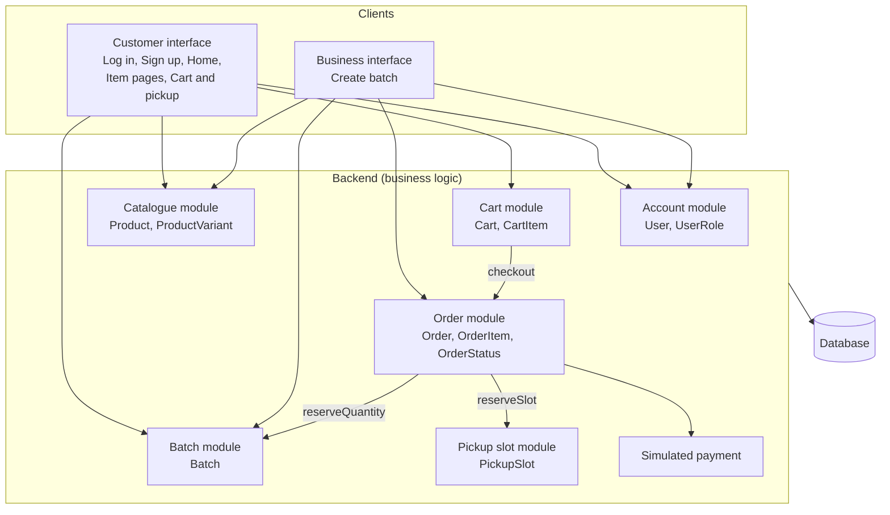
 
| Layer / module | Classes | Responsibility |
|---|---|---|
| **Client** | n/a | Screens shown to customers and business users; sends requests and shows results. |
| **Account module** | `User`, `UserRole` | Registration, login and role permissions. Only a BusinessOwner can manage products. |
| **Catalogue module** | `Product`, `ProductVariant` | Product listings with description, price, photo and variants. |
| **Batch module** | `Batch` | Limited production runs: maximum and remaining quantity, order deadline (`isOpen()`), collection date, and quantity reservation (`reserveQuantity()`). |
| **Pickup slot module** | `PickupSlot` | Collection time windows with a configurable order limit (`isAvailable()`, `reserveSlot()`). |
| **Cart module** | `Cart`, `CartItem` | Holds a customer's selected batches and variants before checkout; `checkout(slot)` creates an order. |
| **Order module** | `Order`, `OrderItem`, `OrderStatus` | Confirmed orders, status changes (`updateStatus()`) from Confirmed to Collected, and cancellation (`cancel()`). |
| **Simulated payment** | not yet modelled | Returns a simulated payment confirmation at checkout. A payment status is planned for Sprint 2. |
| **Database** | all of the above | Stores users, products, variants, batches, pickup slots, carts and orders. |
 
## 4. User Roles

| Role | Main activities |
|---|---|
| Customer | Browse batches, add to cart, choose a pickup slot, place and track orders |
| Business Owner | Manage products, create batches, view orders |
| Kitchen Staff | Update production and order progress |
| Administrator | Manage accounts and settings |
 
---
## 5. Wireframes
All wireframes are mid-fidelity and static. Images are stored in
[`wireframes/`](wireframes/).

### 5.1 Log in
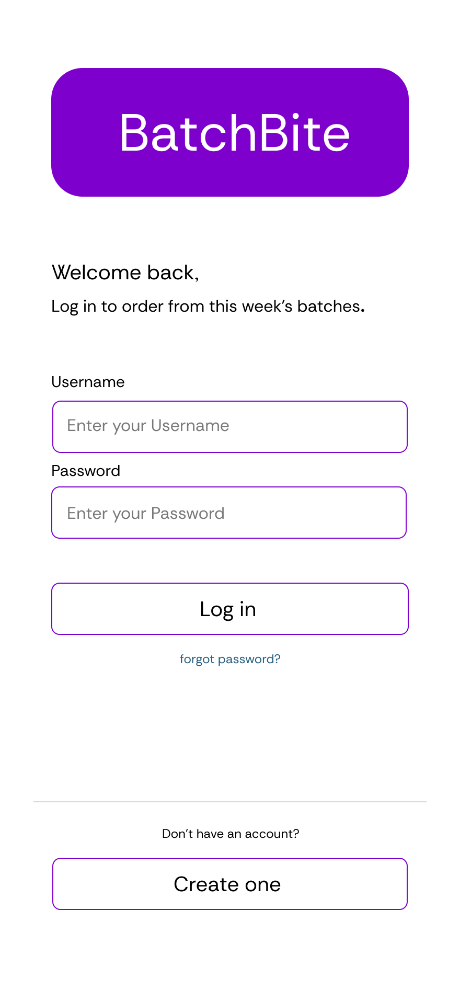

**Purpose:** let returning users access their account.
**Key elements:** BatchBite logo, username and password fields, Log in button, "Forgot
password?" link, and a "Create one" button for new users.
**Design choices:** one primary action per screen; the sign-up route is a secondary button
below a divider so it does not compete with Log in.
**Requirements:** US-01, FR-01, NFR-03.

### 5.2 Sign up
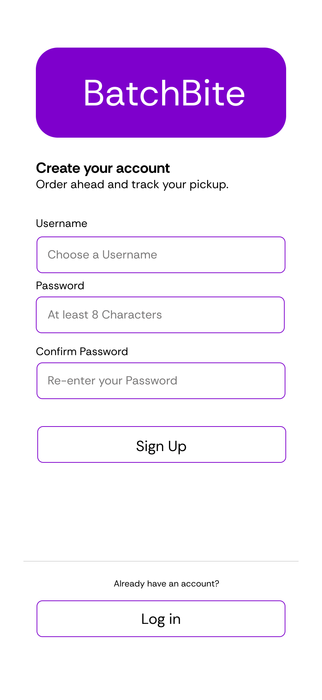

**Purpose:** let new customers create an account.
**Key elements:** logo, username, password and confirm-password fields, Sign up button, and
a link back to Log in.
**Design choices:** a confirm-password field reduces typing mistakes; the layout mirrors the
Log in screen so the two feel like one flow.
**Requirements:** US-01, FR-01, NFR-03.

### 5.3 Home
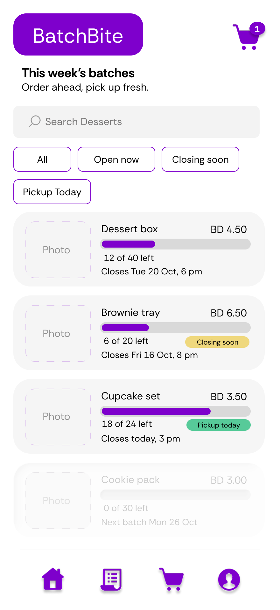

**Purpose:** show customers which batches are open to order.
**Key elements:**
- top bar with logo and cart icon (with item count),
- search field and filter chips (All, Open now, Closing soon, Pickup today),
- batch cards showing photo, name, price, quantity remaining (with a progress bar) and the
  order deadline,
- status badges such as "Closing soon", "Pickup today" and "Sold out",
- bottom navigation (Home, Orders, Cart, Profile).
**Design choices:** sold-out batches stay visible, greyed out, with the next batch date, so
customers know when to come back. The remaining quantity and deadline sit on every card so
nobody has to open an item to find them.
**Requirements:** US-02, FR-04, FR-05.

### 5.4 Item pages (1 to 5)
**Purpose:** show the details of one batch item and let the customer choose options.
**Key elements (shared by all five pages):** large photo, name and price, quantity
remaining with a progress bar, closing time, short description, variant chips, quantity
stepper, expandable "Ingredients and allergens" row, and an Add to cart button showing
the running price.
**Design choices:** all five item pages use one layout, so customers learn it once and
every product is presented the same way. Only the content changes (product, price,
quantity left, variants and closing time). Ingredient and allergen information is
available but collapsed to keep the page short.
**Requirements:** US-02, US-03, FR-02, FR-04.

#### Item page 1: Dessert box
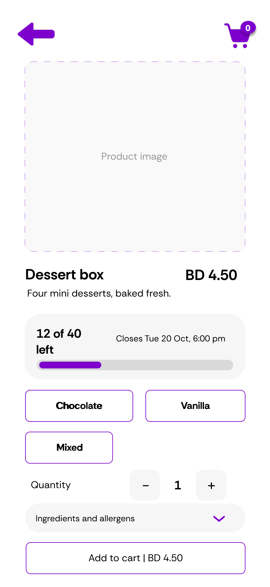

Standard open batch with variant options and plenty of quantity remaining.

#### Item page 2: Brownie tray
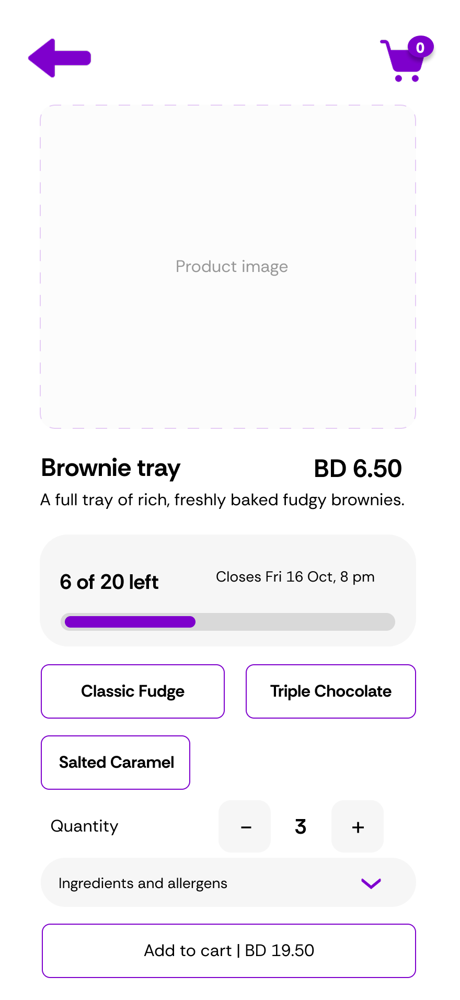

Same layout with a "Closing soon" deadline, showing how urgency is displayed.

#### Item page 3: Cupcake set
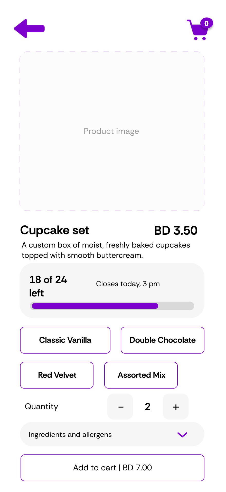

Same layout for a batch with pickup available today.

#### Item page 4: Cookie pack
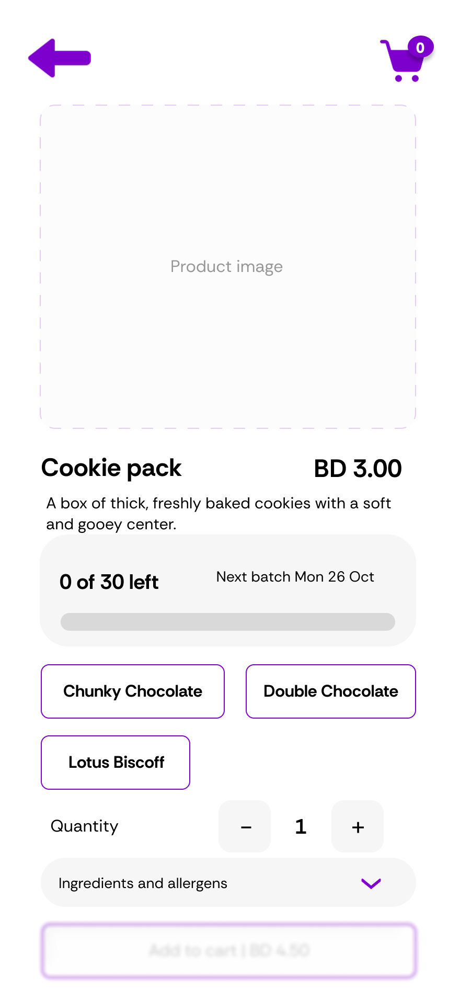

Same layout for a sold-out batch, showing the next batch date instead of an active order button.

#### Item page 5: 
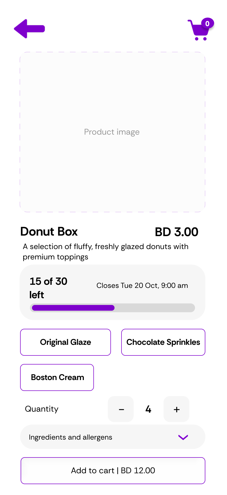

### 5.5 Cart and pickup
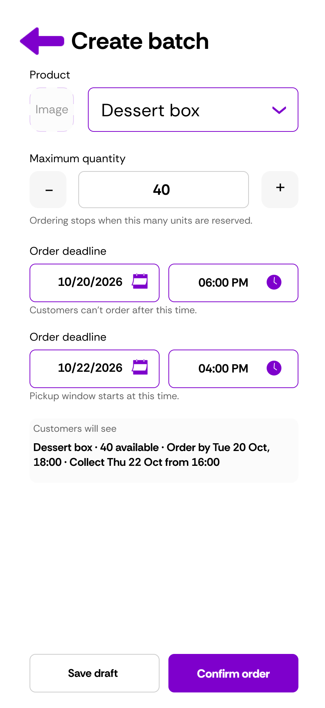

**Purpose:** let the customer review items, choose a pickup slot and confirm the order.
**Key elements:** cart items with quantity controls, pickup slot options showing places
left (full slots cannot be selected), a note field for the baker, subtotal and total, a
simulated payment line and a Confirm order button.
**Design choices:** the pickup slot limit is visible to the customer before they confirm,
which reduces failed checkouts. Payment is clearly labelled as simulated.
**Requirements:** US-03, US-04, FR-04, FR-06, FR-07.

### 5.6 Create batch (business owner)
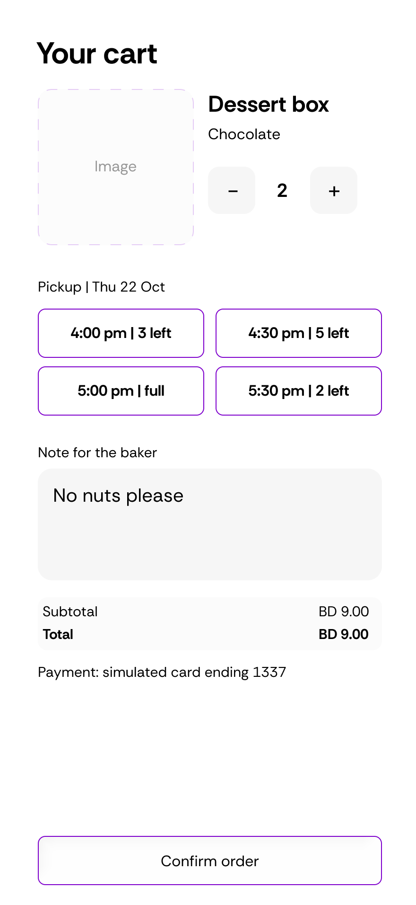
 
**Purpose:** let the owner open a limited production run for a product.
**Key elements:** product selector, maximum quantity stepper, order deadline (date and
time), collection date and time, a "Customers will see" preview, and Save draft and Publish
batch buttons.
**Design choices:** the preview lets the owner check what customers will see before
publishing. The collection time must be later than the order deadline.
**Requirements:** US-06, FR-02, FR-03, FR-05.
 
--- 
## 6. UML Class Diagram
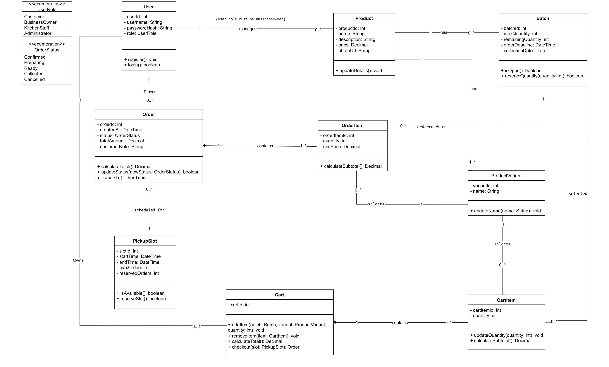
 
The diagram models the core data needed for the Foundation features.
 
### Classes
 
| Class | Main attributes | Main methods | Role in the system |
|---|---|---|---|
| **User** | userId, username, passwordHash, role | register(), login() | Account holder with a role from `UserRole` |
| **Product** | productId, name, description, price, photoUrl | updateDetails() | An item a business sells |
| **ProductVariant** | variantId, name | updateName() | An option of a product (for example, a flavour) |
| **Batch** | batchId, maxQuantity, remainingQuantity, orderDeadline, collectionDate | isOpen(), reserveQuantity(quantity) | A limited production run of a product |
| **PickupSlot** | slotId, startTime, endTime, maxOrders, reservedOrders | isAvailable(), reserveSlot() | A collection time window with a capacity limit |
| **Cart** | cartId | addItem(), removeItem(), calculateTotal(), checkout(slot) | A customer's items before checkout |
| **CartItem** | cartItemId, quantity | updateQuantity(), calculateSubtotal() | One line in a cart |
| **Order** | orderId, createdAt, status, totalAmount, customerNote | calculateTotal(), updateStatus(newStatus), cancel() | A confirmed purchase |
| **OrderItem** | orderItemId, quantity, unitPrice | calculateSubtotal() | One line in an order |
 
**Enumerations**
- `UserRole`: Customer, BusinessOwner, KitchenStaff, Administrator
- `OrderStatus`: Confirmed, Preparing, Ready, Collected, Cancelled
### Relationships
 
| Relationship | Multiplicity | Meaning |
|---|---|---|
| User manages Product | 1 to 0..* | Only a user with the BusinessOwner role can manage products |
| Product has Batch | 1 to 0..* | A product can have many batches over time |
| Product has ProductVariant | 1 to 1..* | Every product has at least one variant |
| User places Order | 1 to 0..* | A customer can place many orders |
| User owns Cart | 1 to 0..1 | A user has at most one active cart |
| Order contains OrderItem | 1 to 1..* (composition) | An order cannot exist without items |
| Cart contains CartItem | 1 to 0..* (composition) | Cart items belong to one cart |
| Order scheduled for PickupSlot | 0..* to 1 | Many orders share one slot, up to its limit |
| OrderItem ordered from Batch | 0..* to 1 | Each order line refers to one batch |
| OrderItem and CartItem select ProductVariant | 0..* to 1 | Each line records the chosen variant |
| CartItem selected from Batch | 0..* to 1 | Each cart line refers to one batch |
 
### Why the model is shaped this way
- **Product and Batch are separate.** The product describes what is sold (name, price,
  variants); the batch describes a limited run of it (maximum quantity, deadline,
  collection date). This matches "40 dessert boxes for Thursday".
- **Quantity and slot checks live on the classes that own the limits** (`reserveQuantity()`
  on Batch, `reserveSlot()` on PickupSlot), so concurrency handling has one clear place to
  be implemented.
- **Order status is an enumeration**, which keeps the allowed states fixed and supports the
  rule that an order cannot be collected before it is ready. The `Cancelled` status and
  `Order.cancel()` let cancelled orders leave the active production list.
### Planned refinements (Sprint 2)
- Link `PickupSlot` to `Batch` (or restrict an order to one batch) so an order cannot mix
  items with different collection dates under a single slot.
- Add a payment status to `Order` (or a small `Payment` class) for the simulated payment
  record.
---

## 7. Order State Diagram
 
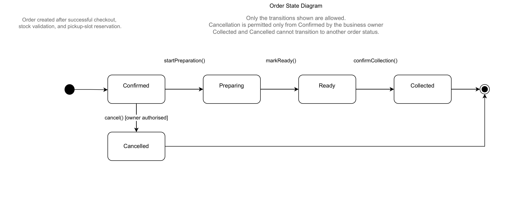
 
The state diagram shows the life cycle of an `Order`, using the values of the `OrderStatus`
enumeration. An order is created in the **Confirmed** state after a successful checkout,
stock validation and pickup-slot reservation. It then moves forward through production and
ends in one of two final states: **Collected** or **Cancelled**.
 
### States
 
| State | Meaning |
|---|---|
| **Confirmed** | Starting state. The order is placed, the quantity and pickup slot are reserved, and the simulated payment is confirmed. |
| **Preparing** | Production of the order has started. |
| **Ready** | The order is prepared and waiting for collection. |
| **Collected** | The customer has picked up the order. Final state. |
| **Cancelled** | The order was cancelled by an authorised business owner. Final state. |
 
### Transitions
 
| From | To | Event | Condition |
|---|---|---|---|
| (start) | Confirmed | Order created at checkout | Checkout succeeded, stock validated, pickup slot reserved |
| Confirmed | Preparing | `startPreparation()` | None |
| Preparing | Ready | `markReady()` | None |
| Ready | Collected | `confirmCollection()` | None |
| Confirmed | Cancelled | `cancel()` | Owner authorised |
| Collected | (end) | None | Final state |
| Cancelled | (end) | None | Final state |
 
### Rules shown by the diagram
- **Only the transitions shown are allowed.** Any other change, for example Confirmed to
  Collected or Preparing to Cancelled, is rejected.
- **An order cannot be collected before it is ready.** Collected can only be reached from
  Ready.
- **Cancellation is permitted only from Confirmed, and only by the business owner.** Once
  preparation has started, the order can no longer be cancelled.
- **Collected and Cancelled are final states.** They cannot change to another status.
- A cancelled order leaves the active production list, and its reserved quantity and pickup
  slot are released so they can be sold again.
### Relationship to the class diagram
The states are the values of the `OrderStatus` enumeration. `Order.cancel()` implements the
cancellation transition, and the other events (`startPreparation()`, `markReady()` and
`confirmCollection()`) are status changes applied through `Order.updateStatus(newStatus)`,
which must reject any change that this diagram does not allow.
 
---

## 8. Requirements Traceability
 
| Requirement | Covered by |
|---|---|
| US-01, FR-01 (accounts and roles) | Log in, Sign up, `User` and `UserRole` |
| US-02 (browse batches) | Home, Item page |
| US-03 (cart and checkout) | Item page, Cart and pickup, `Cart`, `CartItem`, `Order` |
| US-04, FR-06 (pickup slots and limits) | Cart and pickup, `PickupSlot` |
| US-06, FR-03 (create batch) | Create batch, `Batch` |
| FR-02 (product listings) | Item page, Create batch, `Product`, `ProductVariant` |
| FR-04 (reject orders when sold out) | Home and Item page stock display, `Batch.reserveQuantity()` |
| FR-05 (close ordering at deadline) | Order deadline on screens, `Batch.isOpen()` |
| FR-07 (simulated payment) | Cart and pickup |
| NFR-01 (no double-selling of last unit) | Architecture (atomic reservation), `Batch`, `PickupSlot` |
| NFR-03 (security) | Log in, Sign up, `passwordHash`, role checks |
| US-05, US-07, US-08, FR-08, FR-09 (order status and business dashboard) | `OrderStatus`, `Order.updateStatus()`, `Order.cancel()`, Order State Diagram (section 7); dedicated screens planned for Sprint 2 |
 
---
 
## 9. Design Decisions and Assumptions
 
1. **One business to start.** Sprint 1 designs for a single small business with sample data.
   Multiple storefronts can be added later.
2. **One role per user.** A user has a single role stored as an enumeration, instead of a
   separate class per role.
3. **Simulated payment only.** No real payment provider is connected.
4. **Mobile-first layout.** Wireframes use a phone-sized frame; a wider desktop layout can be
   derived later.
5. **Wireframes are not final.** Colours, imagery and typography will be finalised when
   development begins.
---
 
## 10. Out of Scope for Sprint 1
 
These advanced features are planned for later sprints and are not part of this design:
 
- Ingredient planning, recipes and stock reservations
- Production board and kitchen task assignment
- Order changes and refund handling
- QR code collection verification
- Notifications (confirmation, ready, delay, missed collection)
- Sales and production insights
- Recipe and price versioning for confirmed orders
---
 
