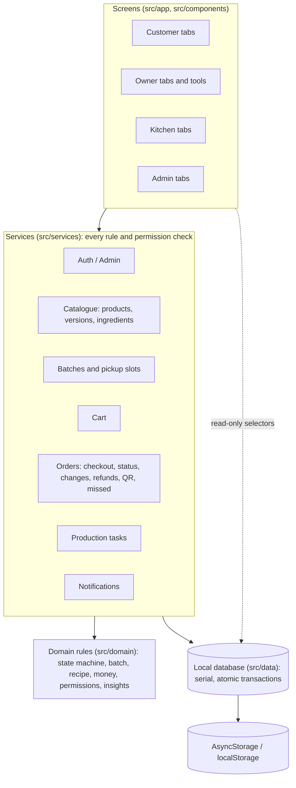

# BatchBite: Phase 2 Core Implementation

**Project:** BatchBite, a preorder and production platform intended for small food businesses
**Team:** Group 10 (Abdulrahman, Ali, Kishan, Shaheem, Saad)
**Phase 2 due:** 15 November 2026

This document explains what was built in Phase 2 and how it was tested.
Setup instructions are in the bottom of [README](/README.md).

---

## 1. Phase 2 goals and where they are met

| Phase 2 goal | Where |
|---|---|
| Implementing core features | All Foundation user stories (Consisting from US-01 to US-08) and FR-01 to FR-09, plus every Sprint 1 "out of scope" feature |
| Conduct initial testing to identifying and fixing early issues | 57 automated tests , plus manual testing of every role in the web build |
| Develop a basic UI for user interactions | 30+ screens built from the Phase 1 wireframes, colours and font |
| Integrate local storage | Transactional local database on AsyncStorage |

## 2. Technology

| Area | Choice | Why |
|---|---|---|
| Framework | Expo SDK 58, React Native 0.88, React 19 | One code base for Android, iOS and web; runs in Expo Go |
| Navigation | Expo Router (file-based) with protected routes | Each role only has its own screens registered |
| Language | TypeScript (strict) | Catches mistakes before running; types mirror the UML |
| Storage | `@react-native-async-storage/async-storage` | Included in Expo Go, works on the web (localStorage) |
| Security | `expo-crypto` | Salted password hashing and secure random codes |
| QR codes | `qrcode` (matrix),`react-native-svg` (drawing) and `expo-camera` (scanning) | Works on every platform; typed code as a fallback |
| Notifications | `expo-notifications`(local) and in-app inbox | No server needed |
| Photos | `expo-image-picker` | Product photos |
| Font | Rethink Sans | From the Phase 1 design |
| Icons | `expo-symbols` | SF Symbols on iOS, Material Symbols on Android/web |
| Tests | Jest with `jest-expo` | Recommended by Expo for SDK 58 |

## 3. Architecture

The app follows the three-layer structure from the design document (section 3), with the backend
modules implemented as services running on the device.

### 3.1 Layers

- **Domain (`src/domain`)**: No imports from React and Expo. Contains the classes that are similar to the UML class diagram, the order state machine, batch rules (isOpen, sold out, badges, eligible slots), recipe maths, money and time formatting, validation, permissions and insights.
- **Services (`src/services`)**: One class for each backend module in the design. All methods start a transaction with the acting user, and verify his or her role; this means that rules apply even when a screen forgets to hide a button (NFR-03)..
- **Data (`src/data`)**: Local database, local schema, read only selectors for screens, demo data.
- **UI (`src/app`, `src/components`)**: Screens read data from the selectors and can only change that data through the services..

### 3.2 Local storage design

- The tables are placed under separate keys each (users, products, batches, orders, etc.), meaning that only the tables that were modified will be rewritten.
- All changes are made using `db.transaction(...)`. Transactions are executed in a queue (one at a time), and the transactions' writes are consolidated into a draft, applied and saved when the transaction completes.
- On start-up every table is validated. A table that cannot be read is copied to a `corrupt` key for inspection and replaced with an empty table, and the log in screen shows a warning, instead of the app crashing.
- A schema version and a migration steps might be in place for future changes.
- The signed-in users are remembered between sessions.

### 3.3 Concurrency (NFR-01)

At checkout, the batch units are validated and reserved, the place to pick up is validated and a batch is reserved, and the ingredients are added to the batch. single transaction. Since transactions are serial, two checkouts are begun at the same time for the
When the first unit reserves one and the second unit tries to reserve it, it is rejected with sold out:
- This is covered by an automated test.

## 4. Sprint 1 "out of scope" features, now implemented

| Feature | Implementation |
|---|---|
| Ingredient planning, recipes and stock reservations | `Ingredient` with stock, reserved amount, low stock level, cost and allergens. There are recipe per unit and extras per option for each product. Ingredients will be reserved at checkout, consumed during production and released during a cancel. When publishing, the Create batch screen checks ingredients to ensure there are no shortages, and the Ingredients screen displays a shopping list when all open batches are sold out. Ingredients and allergens from the recipe are visible to the customers. |
| Production board and kitchen task assignment | Board is organized in groups by stage (To do, Preparing, Ready, Missed) and by day, and includes a "to make" overview and bulk actions. Owners make tasks or generate one task for each order from a batch and assign them to members of the kitchen staff, who begin and complete the tasks. |
| Order changes and refund handling | Order is in Confirmed status, customer requests a change or cancellation (quantity, option, pickup slot, note). Owners give approval/disapproval; if approved, stocks and slots are checked and the difference between the locked price and the current market price is charged/returned in the money. Owners are also able to cancel (full refund) or provide a partial refund, giving them a reason for doing so. Automatic decline of requests when production is started. |
| QR code collection verification | Each order gets a unique 6 character code, shown as a QR code to the customer. It is scanned by staff using the camera or typed in and can only be collected when it is Ready (or Missed). |
| Notifications (confirmation, ready, delay, missed collection) | Recorded in the same transaction as the transaction that "caused" them. Customer notifications include confirmed, preparing, ready, delayed, missed, collected, cancelled, refund and change-request notifications; employee notifications include new order, change request, low stock, task and password reset notifications. Everyone has an in-app inbox and it includes device notifications on phones. Background check is triggered on a Minute basis, and will set uncollected Ready orders as Missed.|
| Sales and production insights | Net revenue (after refunds), Orders, Items, Average Order, Daily Revenue Chart, Top Products, Batch sell-through, Prep time, On-time rate, Collection rate, Slot usage, Cancelled orders, Ingredient cost, and Estimated margin for 7, 14 or 30 days. Each chart comes with its very own table view. |
| Recipe and price versioning for confirmed orders | The name, price, options or recipe of a product can be changed to generate an immutable `ProductVersion`. Orders are not modified when subsequently edited, and the version, price and ingredient reservation they were purchased with are stored in order lines. Version history is displayed in the Product editor. |

## 5. Design decisions taken in Phase 2

1. **Pickup slots belong to a collection day** A cart can be used to collect batches on the same day as the customer selects an available slot that begins at or after the time the batches are collected. Adding an item for another day asks if to start a new cart.
2. **Payment status added to `Order`** (planned refinement): `paid`, `partially refunded` or `refunded`, with a `Payment` record for each simulated charge/refund.
3. **"Missed" status added to the state diagram.** If a delay was reported, Ready → Missed will occur automatically at the end of the slot, or after a grace period (default 30 minutes). It is OK to miss and pick up. All other design rules as in section 7 remain unchanged: The only transitions allowed are those shown, and only Confirmed or Cancelled are final, and only the owner cancel from Confirmed.
4. **Customers request, owners decide.** It's still an owner action, just like the design, customers make a request, the owner approves.
5. **Money is stored in fils** (1 BD = 1000 fils) as whole numbers, so totals never have rounding  errors. Prices show two decimals unless a third is needed.
6. **Forgotten passwords go through the administrator**, because there is no email server: the request alerts admins, who issue a temporary password that must be changed at the next log in.
7. **New sign-ups are customers.** Staff accounts are created by an administrator.
8. **Light theme only**, It is currently using the Phase 1 palette (#7E00CC, #FFFFFF, #000000, #D9D9D9, #F3F3F3, #EFD87D, #58CA99) and Rethink Sans but might be changed. On tablets and the web the layout stays phone-width and centred.
9. **Demo data is generated by replaying activity through the real services** this means that the data always follows the same rules as real data and is always dated around today.
10. **Cross-platform dialogs.** React Native's Alert doesn't contain any buttons or input in the web, instead it has its own confirm dialog and prompt dialog and toasts.

### Changes to the class diagram

| Class | Change |
|---|---|
| `User` | `displayName`, `salt`, `active`, `mustChangePassword` |
| `Product` | `emoji`/`photoUri`, `recipe`, `variantRecipes`, `version`, `currentVersionId`, `active` |
| `ProductVersion` (new) | Immutable price, options and recipe for one version |
| `Ingredient` (new) | Stock, reserved, low stock level, cost, allergens |
| `Batch` | `status` (draft, published, completed) |
| `Order` | `number`, `collectionCode`, `history`, `paymentStatus`, `refundedAmount`, `ingredientReservations`, `delay`, slot snapshot |
| `OrderItem` | `productVersionId`, `productName`, `variantName` snapshot |
| `Payment`, `ChangeRequest`, `ProductionTask`, `AppNotification`, `PasswordResetRequest`, `Settings` (new) | See `src/domain/types.ts` |
| `OrderStatus` | Adds `Missed` |

## 6. Requirements traceability

| Requirement | Implemented in |
|---|---|
| US-01, FR-01 accounts and roles | `auth-service`, `admin-service`, `permissions`, sign in/up screens, protected routes in `src/app/_layout.tsx` |
| US-02 browse batches | `customer/index.tsx`, `batch/[id].tsx`, `customerBatches` selector |
| US-03 cart and checkout | `cart-service`, `OrderService.checkout`, `customer/cart.tsx` |
| US-04, FR-06 pickup slots and limits | `batch-service` slots, `SlotPicker`, `manage/slots.tsx` |
| US-05 order status | `StatusTimeline`, `customer/orders.tsx`, `order/[id].tsx`, notifications |
| US-06, FR-03 create batch | `BatchService.createBatch`, `manage/batch/form.tsx` |
| US-07, FR-09 owner dashboard | `owner/index.tsx`, `manage/batch/[id].tsx` |
| US-08 kitchen updates status | `ProductionBoard`, `OrderService.updateStatus` |
| FR-02 product listings | `CatalogueService`, `owner/products.tsx`, `manage/product/[id].tsx` |
| FR-04 reject when sold out | `OrderService.checkout`, `CartService.addItem` |
| FR-05 close at deadline | `isOpen()` in `domain/batch.ts`, checked at cart and checkout |
| FR-07 simulated payment and summary | `recordPayment`, payment section of the order screen |
| FR-08 status flow, invalid transitions blocked | `domain/order-state.ts` |
| NFR-01 no double-selling | Serial transactions in `data/database.ts`; test in `checkout.test.ts` |
| NFR-02 pages load in 3 s | All data is local and in memory after start-up; screens render from memory |
| NFR-03 hashed passwords, own orders only | `lib/crypto.ts`, `ordersForViewer` / `getOrderForViewer`, service permission checks |
| NFR-04 order in under 2 minutes | Home → item → Add to cart → Cart → slot → Confirm: about six taps |
| NFR-05 README | `README.md` |

## 7. Testing

**Automated** (`npm test`): 57 tests in six suites.

| Suite | Covers |
|---|---|
| `domain/__tests__/domain.test.ts` | Money, state machine, permissions, batch rules and badges, eligible slots, recipes, validation, dates, insights |
| `data/__tests__/database.test.ts` | Persistence across sessions, only changed tables written, rollback on error, storage failure, corrupted data recovery, serial transactions |
| `services/__tests__/checkout.test.ts` | Reservations and payment, FR-04, FR-05, FR-06, NFR-01, ingredient shortage, one collection day per cart, role checks |
| `services/__tests__/order-lifecycle.test.ts` | Full life cycle, invalid transitions, wrong codes, cancellation and refunds, missed pickups, delays, change requests, versioning, tasks |
| `services/__tests__/auth-admin.test.ts` | Sign up validation, hashing, lockout, password reset, deactivation, last admin, settings validation |
| `services/__tests__/seed.test.ts` | Demo data is consistent (stock, slots, payments) at different times of day |

A shared invariant check (`test-utils/invariants.ts`) confirms after each scenario that batch remaining quantities, slot bookings, ingredient reservations and payments all agree with the orders.

**Manual testing** of the web build covered each role: customer browse → cart → checkout → QR code → cancellation request; owner dashboard → approve requests → insights and every management screen; kitchen board → start preparing → verify pickup by code; admin password reset and settings.

**Issues found and fixed during testing**

- Answered change requests showed the order's new state on both sides of the arrow; requests now keep a snapshot of the original lines.
- Old missed pickups stayed in the dashboard's "needs attention" list forever; it now shows the last two days only.
- Editing services during development disconnected screens from the data (Fast Refresh recreated the React context); the context now lives in its own module.
- The demo data depends on the time of day, so it is now tested just after midnight, early morning, late evening and at the end of a month.

## 8. User guide

### 8.1 Customer

1. **Sign up** or log in with a username and a password of at least 8 characters long.
2. **Home** lists this week's batches. Use the search bar or the buttons (which would contain All, Open now, Closing soon, Pickup today). Each card shows the price, how many are left, and when ordering closes. Sold-out batches show when the next batch is.
3. Tap a batch to open the **item page**. Choose an option and quantity, check ingredients and allergens, then tap **Add to cart**.
4. In the **Cart**, adjust quantities, choose a **pickup slot** (full slots are greyed out), add a note for the baker, and tap **Confirm order**. Payment is simulated.
5. The **order screen** shows a QR code and a 6 character code to show at pickup, the status, the pickup time, and the payment. While the order is still Confirmed you can **Request a change** or **Request cancellation**.
6. The bell icon opens **Notifications** (order confirmed, preparing, ready, delayed, missed, refunds). On a phone, turn on **Device notifications** in Profile.

### 8.2 Business owner

- **Dashboard**: today's orders, sales and pickups, items that need attention (change requests, low stock, recent missed pickups), and orders per batch. Tap a batch for its orders, what to make, reserved ingredients, task generation and a batch-wide delay notice.
- **Batches → Create batch**: choose the product, maximum quantity, order deadline and collection time, and the pickup slots for that day. The ingredient check warns about shortages and the preview shows what customers will see. **Save draft** or **Publish batch**.
- **Products**: add or edit products, photo or emoji, options, and the recipe per unit (plus extras per option). Changing price, options or recipe creates a new version; confirmed orders keep theirs.
- **Insights**: revenue, orders, top products, sell-through, pickup performance and ingredient costs.
- **More**: production board, verify pickup, kitchen tasks, change requests, ingredients (adjust stock, low stock levels, shopping list) and pickup slots.
- On any order: start preparing, mark ready, report a delay, cancel (Confirmed only, refunds in full), issue a partial refund, or mark a missed pickup.

### 8.3 Kitchen staff

- **Board**: orders for today, tomorrow or all upcoming, by stage. Tap **Start preparing** and **Mark ready**, or use the bulk buttons. The "to make" card totals what is left to prepare.
- **Tasks**: tasks assigned to you and unassigned ones you can pick up. Start them and mark them done.
- **Scan**: Using the camera and scan the customer's QR code, or typing the code, then **Confirm collection**.

### 8.4 Administrator

- **Users**: search accounts, filter by role, add staff accounts, change roles, deactivate accounts, and answer **password reset requests** by issuing a temporary password (shown once).
- **Settings**: business name, "closing soon" window, pickup grace period, default slot length and capacity, ingredient check at checkout, change requests on/off, simulated card digits, demo account shortcuts, and **Reset demo data**.

## 9. Known limitations and next steps

- One could always use device notifications, but that would require a server for push notifications.
- Payments are simulated.
- bcrypt or Argon2 are good hashing functions for a server, hash is good for a local demo.
- Multiple storefronts (design decision 1 in Sprint 1) are still outside of scope.
- Data is stored per device; a shared backend (for example a REST API with a real database) would let customers and staff use different phones. The service layer was written so it can be moved to a server with the same rules.

