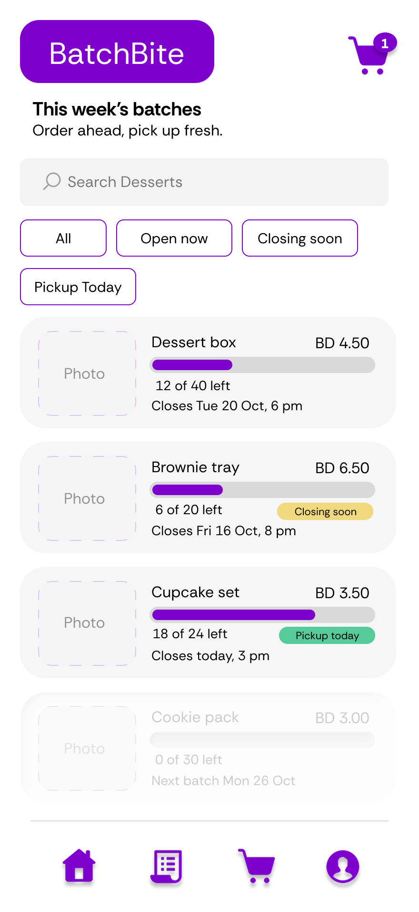

# BatchBite
 
**A preorder and production platform for small food businesses.**
 
BatchBite is a tool for home bakers, student food stalls and small kitchens to control their limited production by placing advance orders. They start a production batch (for instance, 40 dessert boxes for Thursday), customers select what they desire and a pick up time and they receive confirmed demand rather than sporadic messages.
 

 
## The problem
 
Small food businesses often take orders through scattered messages and record them by hand.
This leads to:
 
- overselling a limited batch,
- missed customizations,
- ingredients bought in the wrong amounts,
- crowded pickup times,
- customers not knowing whether their order is confirmed or ready.
BatchBite gives the business one reliable order book that connects ordering, production and
collection.
 
## Features
 
**Foundation features** (designed in Sprint 1, built from Sprint 2)
- Role-based accounts for customers, business owners, kitchen staff and administrators
- Product listings with photos, descriptions, variants and prices
- Production batches with order deadlines, maximum quantities and collection dates
- Shopping cart and checkout with simulated payment confirmation
- Pickup slots with a configurable limit on orders per slot
- Order history and status updates: Confirmed, Preparing, Ready, Collected (or Cancelled)
- Business dashboard for viewing orders and recording cancellations

## Project status
 
Sprint 1 is a planning and design sprint. The requirements, wireframes, architecture, class
diagram and order state diagram are complete. 
 
Tasks are tracked as cards on the team's GitHub Projects Kanban board.
 
## Team
 
| Member | Role |
|---|---|
| Shaheem | Scrum Master, compiles the design document |
| Ali | UML diagrams and reviewing |
| Saad | User stories in the requirements |
| Abdulrahman | Wireframes and requirements |
| Kishan | Wireframes and requirements |


# BatchBite Phase 2

BatchBite is a preorder and production app for home bakers, student food stalls and small businesses, that lets you work effortless .A business starts a limited batch of a product (e.g. 40 dessert boxes for sale) customers pre-order and select collection time, and kitchen operates from one.
This repository holds the **Phase 2 (core implementation)** of the SWEN 360/ CMPE 460 project by Group 10. It is a cross-platform Expo / React Native app working on the Android, iOS and web platforms. All data is stored.

- Design decisions, requirement coverage and the user guide: [`docs/PHASE2.md`](docs/PHASE2.md)
- Phase 1 design document (Sprint 1): requirements, wireframes, UML and the order state diagram

---

## Requirements

- [Node.js](https://nodejs.org) 20 or newer and npm
- One of:
  - the **Expo Go** app on an Android or iOS phone (same Wi-Fi as your computer)
  - an Android emulator / iOS simulator, or a web browser

## Install and run

```bash
npm install
```

```bash
npx expo start
```

Then press:

- `a` to open on an Android emulator or a connected Android phone,
- `i` to open on the iOS simulator (macOS only),
- `w` to open in the web browser,
-  or scan the QR code in the terminal with Expo Go (Android) or the Camera app (iOS).

The first launch creates demo data (about two weeks of orders), which takes a second or two.

### Demo accounts

The log in screen has a **Demo accounts** panel that fills these in for you. Every demo password is
`batchbite`.

| Role | Username | What to try |
|---|---|---|
| Customer | `customer` | Browse batches, add to cart, pick a pickup slot, place an order, show the QR code, request a change |
| Business Owner | `owner` | Dashboard, create a batch, edit a product (creates a new version), approve change requests, refunds, insights, ingredients |
| Kitchen Staff | `kitchen` | Production board, tasks, scan or type a collection code to confirm pickup |
| Administrator | `admin` | Manage accounts, answer the pending password reset for `omar`, change settings, reset demo data |

Other demo customers: `sara`, `omar`, `yusuf`, `maryam`; other kitchen staff: `fatima`.

To start from a clean slate, log in as `admin` → **Settings** → **Reset demo data**.

## Scripts

| Command | What it does |
|---|---|
| `npm start` | Start the Expo dev server |
| `npm run web` / `npm run android` / `npm run ios` | Start and open on that platform |
| `npm test` | Run the unit tests once (Jest) |
| `npm run test:watch` | Re-run tests on every change |
| `npm run typecheck` | TypeScript check (`tsc --noEmit`) |
| `npm run lint` | ESLint with the Expo config |

## Features

**Core (Foundation)**

- Hashed passwords using a unique key per accounts, ranging from four roles (customer, business owner, kitchen staff, administrator). Add log-in lockout for multiple attempts, role-protected screens.
- Customer home page, search, filters (All, Open now, Closing soon, Pickup today), stock progress bars, the dates for deadlines and badges are indicated, sold-out batches appear with the next batch date indicated.
- Item page with options, quantity, ingredients and allergens, and a live price on the button.
- Cart with pickup slots indicating available spaces (full ones won't be picked), a note for baker and a simulated payment.
- Batches that will close the ordering automatically, have a maximum quantity.
- Orders move Confirmed → Preparing → Ready → Collected; invalid changes are blocked.
- This feature displays the owner dashboard of orders per batch.

**Sprint 2 (previously out of scope)**

- **Ingredient planning, recipes and stock reservations**: recipes per product and option, stock Including low stock alerts, shopping list and reserved at checkout when production begins.
- **Production board and kitchen task assignment**
- **Order changes and refund handling**: customers request changes or cancellation; owners approve, Also the price difference is automatically charged or refunded and owners can refund themselves.
- **QR code collection verification**: each order is provided with a QR code, which is scanned by the staff (via camera) or manually typed in 6 character code
- **Notifications**: confirmation, preparing, ready, delay and missed collection for customers, Alerts to staff for new order, change request, low stock and task/password reset. Shown in an in-app Inbox and also as notifications on their devices.
- **Sales and production insights**: recipes per product and option, stock including low stock alerts, shopping list and reserved at checkout when production begins.
- **Recipe and price versioning**: The price and recipe versions of a product are changed when the price or recipe changes

## Project structure

```
src/
  app/            Screens (Expo Router: every file is a route)
    (auth)/       Log in, sign up, forgot password
    customer/     Customer tabs: home, orders, cart, profile
    owner/        Owner tabs: dashboard, batches, products, insights, more
    kitchen/      Kitchen tabs: board, tasks, scan, profile
    admin/        Admin tabs: users, settings, profile
    manage/       Owner and staff tools (batch form, product editor, ingredients, slots, ...)
    batch/[id]    Item page          order/[id]   Order details (QR code, status, payments)
  components/     Reusable UI (ui/ holds the design system: buttons, chips, fields, dialogs)
  domain/         Pure business rules and types (no React): order state machine, batch rules,
                  recipes, money, time, validation, permissions, insights
  services/       Use cases that change data: auth, catalogue, batches, cart, orders, production,
                  notifications, admin. Every check (permissions, stock, deadlines) happens here
  data/           Local database (transactions over AsyncStorage), schema, selectors, demo data
  state/          React provider, hooks and navigation helpers
  lib/            Platform integrations (expo-crypto, device notifications)
  test-utils/     Test helpers (Node crypto, controllable clock, scenarios, invariant checks)
```

## Testing

```bash
npm test
```

57 unit tests cover the business rules end to end through the real services, including:

- FR-04 sold out, FR-05 deadline, FR-06 full pickup slot
- NFR-01: two simultaneous checkouts for the last unit, only one succeeds
- the order state diagram (valid and invalid transitions, who may make them)
- cancellations, partial refunds, change requests and the price difference
- versioning (old orders keep their price and recipe)
- missed pickups and delays
- accounts: hashing, lockout, password reset, admin safeguards
- the database: atomic rollback, storage failures, recovery from corrupted data
- the demo data obeys every stock, slot and payment invariant at different times of day

## Notes and limitations

- Data is stored on one device (AsyncStorage; `localStorage` in the Web). There isn't a server, so two phones Don't give orders to others. Service definitions are created to be able to switch out the local database later with another service.
- Payments are simulated. There is no actual card charged.
- Passwords are salted and then hashed using SHA-256 (50 rounds). A real deployment with a server would utilize bcrypt or Argon2.
- Local notifications on the device require a phone (Expo Go or a development build). On the web the app displays them as in-app messages.
- QR scanning requires a camera, the QR code can always be typed.


 
## Files
 
| Files | Location |
|---|---|
| Requirements (user stories, functional and non-functional requirements) | [`Docs/Requirements.md`](Docs/Requirements.md) |
| Initial design (architecture, wireframes, class and state diagrams) | [`Docs/Design/Design.md`](Docs/Design/Design.md) |
| Phase 2(architecture, core features, layers, designs) | [`Docs/Phase2.md`](Docs/Phase2.md) |
| Wireframe images | [`Docs/Design/Wireframes/`](Docs/Design/Wireframes/) |
| Kanban board notes and screenshots | [`Docs/Proof/Kanban-board.md`](Docs/Proof/Kanban-board.md) |
| Kanban board notes and screenshots Sprint 2 | [`Docs/Proof/Kanban-board.md`](Docs/Proof/Kanban-board_Sprint2.md) |
| Sprint 1 Meeting minutes | [`Docs/Proof/Meeting-minutes.md`](Docs/Proof/Meeting-minutes_Sprint1.md) |
| Sprint 2 Meeting minutes | [`Docs/Proof/Meeting-minutes.md`](Docs/Proof/Meeting-minutes_Sprint2.md) |
| How AI is used in this project | [`Claude_Usage.md`](Claude_Usage.md) |
 
Tasks are tracked as cards on the team's GitHub Projects Kanban board.


 
## Courses
 
SWEN 360 Software Design and Engineering
SWEN 360L-1 Software Design and Engineering Laboratory
